# Use Case Diagram — Campus CMMS

## Title
**UC-01: Use Case Diagram — All Actors and System Use Cases (FR-01 to FR-13)**

---

## Diagram

```mermaid
graph TD
    %% ─── Actors ───────────────────────────────────────────────────────────────
    Admin(["👤 Admin"])
    Tech(["👷 Technician"])
    Req(["🎓 Requester\n(Student/Staff)"])
    Sched(["⚙️ Scheduler\n(System/Cron)"])

    %% ─── Authentication — FR-01 ───────────────────────────────────────────────
    subgraph AUTH ["🔐 Authentication (FR-01)"]
        UC01A["Login"]
        UC01B["Logout"]
        UC01C["Admin: Create User Account"]
        UC01D["Change Password"]
    end

    %% ─── Asset Management — FR-02, FR-03, FR-04 ──────────────────────────────
    subgraph ASSET ["🏗️ Asset & Location Management (FR-02, FR-03, FR-04)"]
        UC02A["Create / Edit Asset"]
        UC02B["View Asset List"]
        UC02C["View Asset Detail"]
        UC03A["Manage Locations\n(Campus→Building→Floor→Room)"]
        UC03B["Manage Asset Categories"]
        UC04A["Generate QR Code"]
        UC04B["Scan QR → Open Asset Page"]
    end

    %% ─── Maintenance Requests — FR-05, FR-06 ─────────────────────────────────
    subgraph REQUEST ["📋 Maintenance Requests (FR-05, FR-06)"]
        UC05A["Submit Maintenance Request"]
        UC05B["Track Own Requests"]
        UC06A["Review Pending Request"]
        UC06B["Approve Request"]
        UC06C["Reject Request (with reason)"]
        UC06D["Convert Request to Work Order"]
    end

    %% ─── Work Orders — FR-07 ──────────────────────────────────────────────────
    subgraph WO ["🔧 Work Order Management (FR-07)"]
        UC07A["Create Work Order (manual)"]
        UC07B["Assign WO to Technician"]
        UC07C["Update WO Status"]
        UC07D["Log Notes on WO"]
        UC07E["Log Time Spent"]
        UC07F["Record Parts Used"]
        UC07G["View WO Status History"]
        UC07H["Close Work Order"]
    end

    %% ─── Preventive Maintenance — FR-08 ──────────────────────────────────────
    subgraph PM ["📅 Preventive Maintenance (FR-08)"]
        UC08A["Create PM Schedule"]
        UC08B["Edit PM Checklist"]
        UC08C["Auto-Generate PM Work Order"]
        UC08D["View PM Schedules"]
    end

    %% ─── Inventory — FR-09 ───────────────────────────────────────────────────
    subgraph INV ["📦 Inventory Management (FR-09)"]
        UC09A["Manage Parts Catalogue"]
        UC09B["Manage Suppliers"]
        UC09C["Deduct Stock on Part Use"]
        UC09D["View Low-Stock Alerts"]
    end

    %% ─── Notifications — FR-10 ───────────────────────────────────────────────
    subgraph NOTIF ["🔔 Notifications (FR-10)"]
        UC10A["Receive Assignment Notification"]
        UC10B["Receive Status-Change Notification"]
        UC10C["Receive Overdue WO Alert"]
        UC10D["Receive Low-Stock Alert"]
    end

    %% ─── Dashboard & Reports — FR-11, FR-12, FR-13 ───────────────────────────
    subgraph DASH ["📊 Dashboard, Reports & Audit (FR-11, FR-12, FR-13)"]
        UC11A["View Dashboard"]
        UC12A["Generate Report"]
        UC12B["Export Report as CSV"]
        UC12C["Export Report as PDF"]
        UC13A["View Audit Log"]
    end

    %% ─── Actor Connections ────────────────────────────────────────────────────
    %% Admin
    Admin --> UC01A & UC01B & UC01C & UC01D
    Admin --> UC02A & UC02B & UC02C & UC03A & UC03B & UC04A
    Admin --> UC06A & UC06B & UC06C & UC07A & UC07B & UC07H
    Admin --> UC08A & UC08B & UC08D
    Admin --> UC09A & UC09B & UC09D
    Admin --> UC11A & UC12A & UC12B & UC12C & UC13A

    %% Technician
    Tech --> UC01A & UC01B
    Tech --> UC02B & UC02C & UC04B
    Tech --> UC07C & UC07D & UC07E & UC07F & UC07G
    Tech --> UC10A & UC10B & UC10C
    Tech --> UC11A

    %% Requester
    Req --> UC01A & UC01B
    Req --> UC02C & UC04B & UC05A & UC05B
    Req --> UC10B

    %% Scheduler (System)
    Sched --> UC08C & UC10C & UC10D & UC09C

    %% ─── Include / Extend Relationships ───────────────────────────────────────
    UC06B -- "«include»\nAuto-creates" --> UC06D
    UC06D -- "«include»\nMay include" --> UC07B
    UC07F -- "«include»\nTriggers" --> UC09C
    UC07B -- "«include»\nSends" --> UC10A
    UC07C -- "«include»\nSends" --> UC10B
    UC05A -- "«extend»\nvia QR" --> UC04B
    UC12A -- "«extend»" --> UC12B
    UC12A -- "«extend»" --> UC12C
```

---

## Plain-English Walkthrough (Viva Notes)

This diagram shows all four actors in the CMMS system and the use cases they interact with, grouped by functional area.

**Actors:**
- **Admin** is the most privileged user who can manage assets, locations, categories, users, approve/reject maintenance requests, create work orders, and view all reports and audit logs.
- **Technician** focuses on the operational side — receiving assigned work orders, updating their status, logging time and parts used, and viewing the dashboard.
- **Requester** (student or staff) can submit maintenance requests, track their own request status, and use a QR code to quickly access an asset page.
- **Scheduler** is a background system actor (cron job) that automatically generates preventive maintenance work orders and triggers overdue/low-stock notifications — it has no human interaction.

**Key «include» and «extend» relationships:**
- *Approve Request* **includes** *Convert Request to Work Order* — approval always creates a WO automatically.
- *Convert Request to WO* **includes** *Assign Technician* — the admin can optionally assign during approval.
- *Record Parts Used* **includes** *Deduct Stock* — logging parts on a WO triggers an atomic inventory deduction.
- *Assign Technician* **includes** *Send Assignment Notification* — the technician is notified immediately.
- *Submit Maintenance Request* **extends** *Scan QR Code* — the QR scan is an optional fast path into the request flow.
- *Generate Report* **extends** to either *Export CSV* or *Export PDF* — both are optional export formats.

Every FR (FR-01 through FR-13) is represented by at least one use case in this diagram, ensuring full traceability.
