# ER Diagram — Campus CMMS

## Title
**ER-02: Entity-Relationship Diagram — All 17 Entities with Attributes, PKs, FKs, and Cardinalities**

---

## Diagram

```mermaid
erDiagram
    User {
        string  id          PK  "cuid"
        string  email       UK  "unique"
        string  name
        string  password        "bcrypt hash"
        enum    role            "ADMIN|TECHNICIAN|REQUESTER"
        boolean isActive        "default true"
        string  phone
        string  avatarUrl
        datetime createdAt
        datetime updatedAt
    }

    Location {
        string  id          PK  "cuid"
        string  name
        enum    type            "CAMPUS|BUILDING|FLOOR|ROOM"
        string  parentId    FK  "nullable → Location.id"
        datetime createdAt
        datetime updatedAt
    }

    Category {
        string  id          PK  "cuid"
        string  name        UK
        string  description
        string  parentId    FK  "nullable → Category.id"
        datetime createdAt
        datetime updatedAt
    }

    Asset {
        string   id             PK  "cuid"
        string   assetCode      UK  "auto-generated"
        string   name
        string   categoryId     FK  "→ Category.id"
        string   locationId     FK  "→ Location.id"
        string   manufacturer
        string   serialNo       UK  "nullable"
        datetime purchaseDate
        datetime warrantyExpiry
        enum     status             "ACTIVE|UNDER_MAINTENANCE|RETIRED"
        string   photoUrl
        string   qrCodeUrl
        string   notes
        datetime createdAt
        datetime updatedAt
    }

    MaintenanceRequest {
        string   id              PK  "cuid"
        string   requesterId     FK  "→ User.id"
        string   assetId         FK  "nullable → Asset.id"
        string   locationId      FK  "nullable → Location.id"
        string   description
        enum     priority            "LOW|MEDIUM|HIGH|CRITICAL"
        enum     status              "PENDING|APPROVED|REJECTED"
        string   rejectionReason
        string   photoUrl
        datetime createdAt
        datetime updatedAt
    }

    WorkOrder {
        string   id                      PK  "cuid"
        string   title
        string   description
        string   maintenanceRequestId    FK  "nullable UK → MaintenanceRequest.id"
        string   assetId                FK  "nullable → Asset.id"
        enum     priority                    "LOW|MEDIUM|HIGH|CRITICAL"
        string   assigneeId             FK  "nullable → User.id"
        string   createdById            FK  "→ User.id"
        datetime dueDate
        enum     status                     "OPEN|ASSIGNED|IN_PROGRESS|ON_HOLD|COMPLETED|CLOSED"
        float    estimatedCost
        float    actualCost
        float    timeSpent                  "hours"
        string   pmScheduleId          FK  "nullable → PMSchedule.id"
        datetime createdAt
        datetime updatedAt
    }

    WorkOrderStatusHistory {
        string   id           PK  "cuid"
        string   workOrderId  FK  "→ WorkOrder.id"
        enum     fromStatus       "nullable"
        enum     toStatus
        string   changedById  FK  "→ User.id"
        string   reason
        datetime createdAt
    }

    WorkOrderNote {
        string   id           PK  "cuid"
        string   workOrderId  FK  "→ WorkOrder.id"
        string   authorId     FK  "→ User.id"
        string   content
        datetime createdAt
        datetime updatedAt
    }

    PMSchedule {
        string   id              PK  "cuid"
        string   name
        string   assetId         FK  "→ Asset.id"
        int      frequencyDays
        datetime lastGeneratedAt
        datetime nextDueDate
        boolean  isActive            "default true"
        string   description
        datetime createdAt
        datetime updatedAt
    }

    PMChecklistItem {
        string  id          PK  "cuid"
        string  scheduleId  FK  "→ PMSchedule.id"
        string  description
        int     order
    }

    Supplier {
        string   id           PK  "cuid"
        string   name
        string   contactName
        string   email
        string   phone
        string   address
        datetime createdAt
        datetime updatedAt
    }

    Part {
        string   id           PK  "cuid"
        string   partCode     UK
        string   name
        string   description
        int      stockQty         "default 0"
        int      reorderLevel     "default 5"
        float    unitCost
        string   supplierId   FK  "nullable → Supplier.id"
        boolean  isActive         "default true"
        datetime createdAt
        datetime updatedAt
    }

    WorkOrderPart {
        string  id             PK  "cuid"
        string  workOrderId    FK  "→ WorkOrder.id"
        string  partId         FK  "→ Part.id"
        int     quantityUsed
        float   unitCostAtTime     "snapshot at time of use"
        datetime createdAt
    }

    Notification {
        string   id              PK  "cuid"
        string   userId          FK  "→ User.id"
        enum     type                "ASSIGNMENT|STATUS_CHANGE|OVERDUE|LOW_STOCK|GENERAL"
        string   title
        string   message
        boolean  isRead              "default false"
        string   referenceId
        string   referenceType
        datetime createdAt
    }

    AuditLog {
        string   id          PK  "cuid"
        string   userId      FK  "nullable → User.id"
        string   action
        string   entityType
        string   entityId
        json     details
        string   ipAddress
        datetime createdAt
    }

    Attachment {
        string   id            PK  "cuid"
        string   entityType        "polymorphic: ASSET|WO|REQUEST"
        string   entityId          "ID of related entity"
        string   fileName
        string   fileUrl
        int      fileSize
        string   mimeType
        string   uploadedById  FK  "→ User.id"
        datetime createdAt
    }

    %% ─── Relationships ────────────────────────────────────────────────────────
    Location        ||--o{ Location            : "parent-child (self)"
    Category        ||--o{ Category            : "parent-child (self)"
    Category        ||--o{ Asset               : "categorises"
    Location        ||--o{ Asset               : "housed in"
    Asset           ||--o{ MaintenanceRequest  : "reported for"
    Location        ||--o{ MaintenanceRequest  : "reported at"
    User            ||--o{ MaintenanceRequest  : "submitted by"
    MaintenanceRequest ||--o| WorkOrder        : "converts to (1:0..1)"
    Asset           ||--o{ WorkOrder           : "maintained by"
    User            ||--o{ WorkOrder           : "assigned to (technician)"
    User            ||--o{ WorkOrder           : "created by (admin)"
    PMSchedule      ||--o{ WorkOrder           : "generates"
    WorkOrder       ||--o{ WorkOrderStatusHistory : "has history"
    User            ||--o{ WorkOrderStatusHistory : "changed by"
    WorkOrder       ||--o{ WorkOrderNote       : "has notes"
    User            ||--o{ WorkOrderNote       : "authored by"
    WorkOrder       ||--o{ WorkOrderPart       : "uses parts"
    Part            ||--o{ WorkOrderPart       : "used in"
    Asset           ||--o{ PMSchedule          : "scheduled for"
    PMSchedule      ||--o{ PMChecklistItem     : "has checklist"
    Supplier        ||--o{ Part               : "supplies"
    User            ||--o{ Notification        : "receives"
    User            ||--o{ AuditLog            : "generates"
    User            ||--o{ Attachment          : "uploaded by"
```

---

## Normalisation Notes

| Entity | Normal Form | Notes |
|---|---|---|
| All entities | 3NF | Each non-key attribute depends only on the primary key (cuid). No transitive dependencies. |
| `Location` | 3NF | Self-referential FK (`parentId`) represents the hierarchy without storing the full path string — this avoids transitive dependency. |
| `WorkOrderPart` | 3NF | Junction table with `unitCostAtTime` — a **deliberate denormalisation**: price at time of use is recorded independently of `Part.unitCost`, which may change later. This ensures historical cost accuracy in reports. |
| `Attachment` | 3NF | Uses **polymorphic association** (entityType + entityId strings) instead of separate FK columns per entity type. This is a pragmatic design choice; Prisma does not support multi-target polymorphic FK constraints, and the trade-off (no DB-level referential integrity on the entityId) is accepted in favour of model simplicity. |
| `WorkOrder.actualCost` | Denorm | Could be computed as `SUM(WorkOrderPart.quantityUsed * unitCostAtTime)` but is stored to allow manual cost adjustments (e.g., labour surcharges). Justified denormalisation. |

---

## Plain-English Walkthrough (Viva Notes)

This ER diagram shows all 17 entities of the CMMS database, their attributes with data types and constraints, and the relationships (with cardinalities) between them.

Starting from the top: a **User** can be an Admin, Technician, or Requester. **Locations** form a four-level tree (Campus → Building → Floor → Room) using a self-referential parentId. **Categories** similarly use a self-join for asset categorisation.

An **Asset** belongs to exactly one Category and one Location. Each asset can receive many **MaintenanceRequests** (from Requesters). When an Admin approves a request, it converts to exactly one **WorkOrder** (1-to-0..1 relationship). Work Orders can also be created manually or by the PM **PMSchedule** scheduler.

A **WorkOrder** is assigned to one Technician (User) and tracks its entire life via **WorkOrderStatusHistory** (every status change is a row), **WorkOrderNote** (technician notes), and **WorkOrderPart** (parts used — a junction table linking WorkOrder to Part, capturing the unit cost at time of use for financial reporting accuracy).

**PMSchedule** links to an Asset and holds a set of **PMChecklistItem** rows for the inspection checklist. **Supplier** provides **Part** inventory items. **Notification** and **AuditLog** tables capture system events and admin-visible action history respectively. **Attachment** uses a polymorphic design (entityType + entityId) to link files to any entity.
