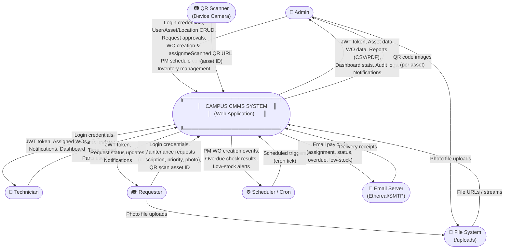

# DFD Level 0 — Context Diagram — Campus CMMS

## Title
**DFD-03: Level 0 Context Diagram — CMMS as a Single System Process**

---

## Diagram

---

## Plain-English Walkthrough (Viva Notes)

This is a **Level 0 (Context) DFD** — the CMMS is treated as a single black-box process, and we only show external entities and the data flowing in and out.

There are seven external entities:

1. **Admin** sends management commands (login, CRUD on assets/locations/users, approvals, PM config, inventory management) and receives data back (JWT, reports, dashboards, audit logs, notifications).
2. **Technician** sends WO updates (status changes, notes, time, parts used) and receives assigned WO details and notifications.
3. **Requester** sends maintenance requests and QR-scan asset IDs; receives request status updates and notifications.
4. **Scheduler / Cron** sends periodic time triggers; the system uses these to generate PM work orders, check for overdue WOs, and detect low stock — results are reported back.
5. **Email Server (Ethereal/SMTP)** receives formatted email payloads from the system for delivery; confirms delivery back.
6. **File System (/uploads)** receives photo/document uploads from users (routed via Multer middleware); returns file URLs and byte streams to the system.
7. **QR Scanner (Device Camera)** sends the scanned asset URL to the system (via browser navigation); the system emits QR code images for each asset so they can be printed/displayed.

This diagram satisfies the coverage of all 13 FRs at the system boundary level, showing what data enters and leaves the system without yet revealing internal processes.
