# DFD Level 1 — Campus CMMS

## Title
**DFD-04: Level 1 Data Flow Diagram — Eight Core Processes with Data Stores**

---

## Diagram

```mermaid
flowchart TD
    %% ─── External Entities ────────────────────────────────────────────────────
    Admin(["👤 Admin"])
    Tech(["👷 Technician"])
    Req(["🎓 Requester"])
    Sched(["⚙️ Scheduler"])
    SMTP(["📧 SMTP Server"])
    FS(["📁 File System"])

    %% ─── Data Stores ──────────────────────────────────────────────────────────
    DS1[("DS1\nUsers")]
    DS2[("DS2\nAssets")]
    DS3[("DS3\nLocations &\nCategories")]
    DS4[("DS4\nMaintenance\nRequests")]
    DS5[("DS5\nWork Orders &\nHistory")]
    DS6[("DS6\nPM Schedules &\nChecklists")]
    DS7[("DS7\nInventory\n(Parts & Suppliers)")]
    DS8[("DS8\nNotifications")]
    DS9[("DS9\nAudit Log")]
    DS10[("DS10\nAttachments")]

    %% ─── Process 1: Authentication ────────────────────────────────────────────
    P1["P1\nAuthentication\n& RBAC"]
    Admin & Tech & Req -->|"email + password"| P1
    P1 -->|"read/write user record"| DS1
    P1 -->|"JWT token"| Admin & Tech & Req
    P1 -->|"auth events"| DS9

    %% ─── Process 2: Asset Management ─────────────────────────────────────────
    P2["P2\nAsset\nManagement"]
    Admin -->|"asset data,\nphoto upload"| P2
    P2 -->|"store / retrieve assets"| DS2
    P2 -->|"read categories & locations"| DS3
    P2 -->|"store photo reference"| DS10
    P2 -->|"QR code image"| Admin & Req & Tech
    P2 -->|"asset list / detail"| Admin & Req & Tech
    P2 -->|"asset CRUD events"| DS9
    FS -->|"photo URL"| P2
    P2 -->|"write file"| FS

    %% ─── Process 3: Request Handling ─────────────────────────────────────────
    P3["P3\nRequest\nHandling"]
    Req -->|"request details,\nphoto"| P3
    Admin -->|"approve / reject decision"| P3
    P3 -->|"store / read requests"| DS4
    P3 -->|"read assets"| DS2
    P3 -->|"read locations"| DS3
    P3 -->|"store attachment"| DS10
    P3 -->|"request status updates"| Req
    P3 -->|"approved request"| P4
    P3 -->|"request events"| DS9

    %% ─── Process 4: Work Order Management ────────────────────────────────────
    P4["P4\nWork Order\nManagement"]
    Admin -->|"WO create / assign / close"| P4
    Tech -->|"status update, notes,\ntime, parts used"| P4
    P3 -->|"approved request → create WO"| P4
    P6 -->|"PM-generated WO"| P4
    P4 -->|"store / read WOs\n& status history"| DS5
    P4 -->|"read assets"| DS2
    P4 -->|"read users (assignees)"| DS1
    P4 -->|"deduct stock"| P5
    P4 -->|"WO detail / list"| Admin & Tech
    P4 -->|"trigger notifications"| P7
    P4 -->|"WO events"| DS9

    %% ─── Process 5: Inventory Management ─────────────────────────────────────
    P5["P5\nInventory\nManagement"]
    Admin -->|"part / supplier CRUD"| P5
    P4 -->|"parts-used entries"| P5
    P5 -->|"store / read parts & suppliers"| DS7
    P5 -->|"low-stock flag → notification"| P7
    P5 -->|"inventory list"| Admin
    P5 -->|"inventory events"| DS9

    %% ─── Process 6: PM Scheduling ─────────────────────────────────────────────
    P6["P6\nPreventive\nMaintenance\nScheduling"]
    Admin -->|"schedule config,\nchecklist items"| P6
    Sched -->|"cron tick"| P6
    P6 -->|"store / read PM schedules"| DS6
    P6 -->|"read assets"| DS2
    P6 -->|"generate WO"| P4
    P6 -->|"PM schedule list"| Admin
    P6 -->|"PM events"| DS9

    %% ─── Process 7: Notifications ─────────────────────────────────────────────
    P7["P7\nNotification\nService"]
    P4 -->|"assignment, status-change,\noverdue events"| P7
    P5 -->|"low-stock events"| P7
    P7 -->|"store notifications"| DS8
    P7 -->|"read user contacts"| DS1
    P7 -->|"email payload"| SMTP
    P7 -->|"in-app notification list"| Admin & Tech & Req

    %% ─── Process 8: Reporting & Audit ─────────────────────────────────────────
    P8["P8\nReporting &\nAudit"]
    Admin -->|"report parameters,\ndate range, filters"| P8
    P8 -->|"read all data stores"| DS5 & DS7 & DS9
    P8 -->|"aggregate WO data"| DS5
    P8 -->|"aggregate inventory data"| DS7
    P8 -->|"read audit log"| DS9
    P8 -->|"dashboard stats,\nCSV / PDF report"| Admin
```

---

## Plain-English Walkthrough (Viva Notes)

This Level 1 DFD decomposes the single CMMS process (from Level 0) into **eight sub-processes**, each corresponding to a major functional area. Ten data stores persist the system's data.

**P1 — Authentication & RBAC:** All three human actors authenticate here. Valid credentials produce a JWT token; failed attempts are logged. The middleware in every other process implicitly calls P1 logic to verify tokens.

**P2 — Asset Management:** Admins (and to a lesser extent technicians and requesters) interact with the asset catalogue. This process reads from the Location and Category stores, writes asset records, generates QR codes, and stores photo references in the filesystem and attachment store.

**P3 — Request Handling:** Requesters submit maintenance requests which are stored in DS4. Admins approve or reject them. On approval, the processed request flows into P4 (Work Order Management) to automatically create a Work Order.

**P4 — Work Order Management:** The central process. Receives WOs from three sources: request approval (P3), PM scheduler (P6), and direct Admin creation. Technicians update status, log time, and record parts — which triggers stock deduction via P5. Every status change fires P7 (Notifications) and writes to DS9 (Audit Log).

**P5 — Inventory Management:** Manages parts and suppliers. Receives part-usage events from P4 and decrements stock atomically. Detects low-stock conditions and signals P7 to alert the Admin.

**P6 — PM Scheduling:** Admin configures schedules; the Scheduler cron tick drives automatic WO generation. It checks DS6 to avoid duplicate generation and updates `lastGeneratedAt` / `nextDueDate` after creating a WO via P4.

**P7 — Notification Service:** Aggregates events from P4 and P5, writes in-app notifications to DS8, reads user contact info from DS1, and dispatches email payloads to the SMTP server.

**P8 — Reporting & Audit:** Read-only aggregation over all relevant data stores. Produces dashboard statistics, filtered reports, and CSV/PDF exports for Admins. Also exposes the Audit Log (DS9).
