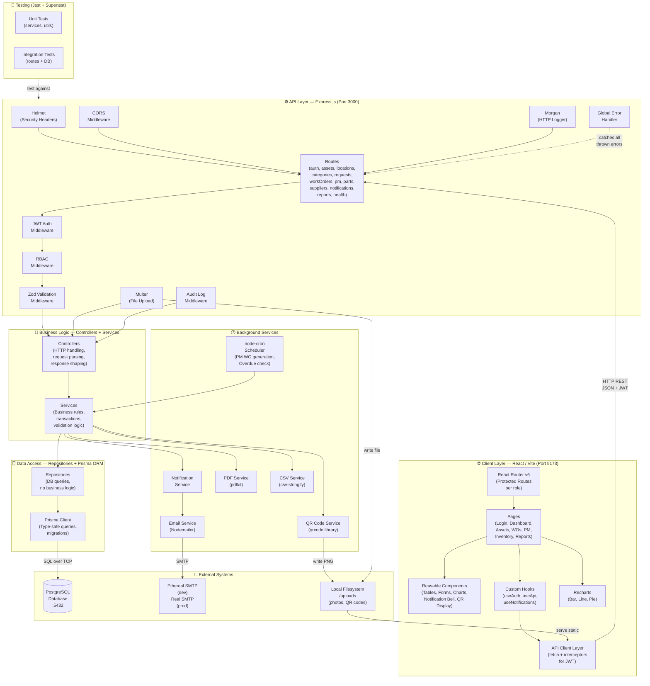

# System Architecture Diagram — Campus CMMS

## Title
**ARCH-05: System Architecture — Layers, Components, and External Integrations**

---

## Diagram

---

## Plain-English Walkthrough (Viva Notes)

This diagram shows the full system architecture of the CMMS, divided into six layers/areas.

**Client Layer (React / Vite):** The user interacts with React pages (Dashboard, Assets, WOs, etc.) built with Tailwind CSS. React Router enforces role-based protected routes. Recharts renders dashboard charts. A thin API client layer attaches JWT tokens to every outbound request.

**API Layer (Express.js):** Incoming HTTP requests pass through a middleware chain: Helmet sets security headers, CORS allows the React origin, Morgan logs requests, JWT Auth verifies the token, RBAC checks the user's role against the route's required permission, and Zod Validation parses and validates the request body. Multer handles file uploads. An Audit middleware logs sensitive actions. A global error handler catches any unhandled exceptions and returns a consistent `{ success, message, data }` JSON response.

**Business Logic Layer (Controllers + Services):** Controllers are thin — they parse HTTP input and call the appropriate Service. Services contain all business rules, enforce transactions, and coordinate between multiple repositories and background services.

**Data Access Layer (Repositories + Prisma):** Repositories contain only database query logic (no business rules). They use Prisma Client to issue type-safe, parameterised SQL queries against PostgreSQL — preventing SQL injection.

**Background Services:** `node-cron` runs scheduled tasks (PM WO generation, overdue detection). The Notification Service writes in-app records and delegates email dispatch to Nodemailer. QR code, PDF, and CSV services are utility modules called by Services on demand.

**External Systems:** PostgreSQL is the sole datastore. Ethereal SMTP (a free test SMTP service) handles emails in development; a real SMTP provider is configured via `.env` for production. The local filesystem (`/uploads`) stores photos and generated QR code images.
