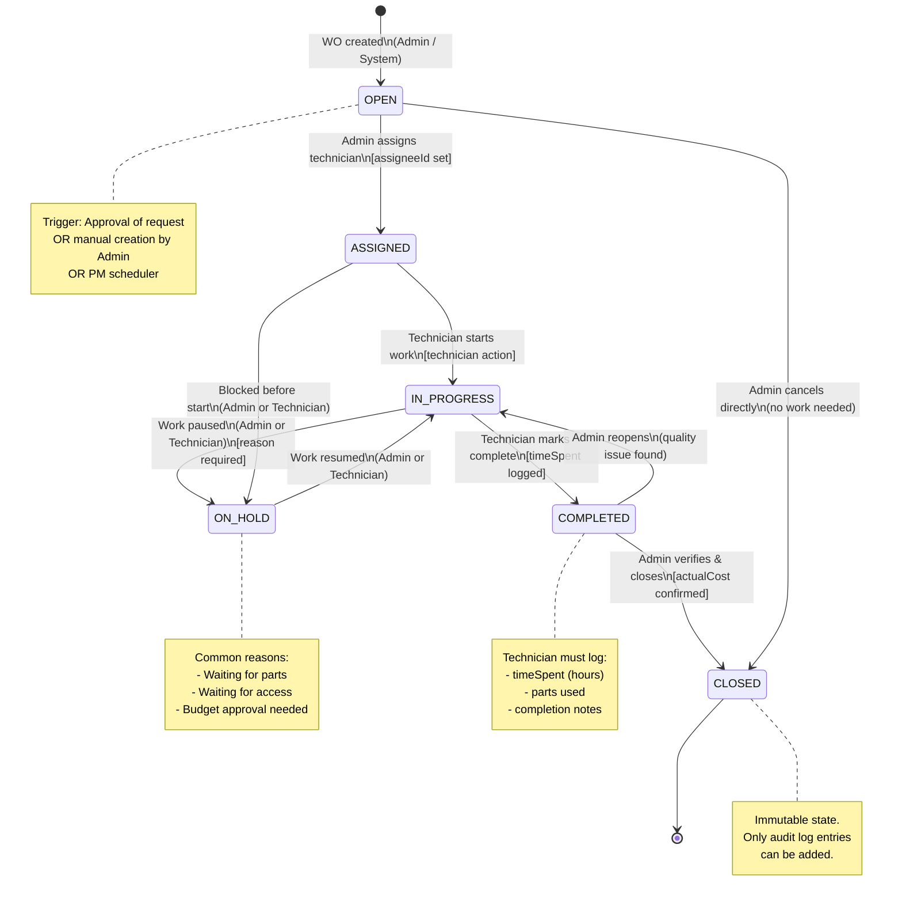

# Work Order State Diagram — Campus CMMS

## Title
**SD-06: Work Order Status-Transition State Diagram (FR-07)**

---

## Diagram

---

## Allowed Transitions Reference Table

| From | To | Who Can Trigger | Condition |
|---|---|---|---|
| *(new)* | OPEN | Admin / Scheduler / System | WO created (from request, manual, or PM) |
| OPEN | ASSIGNED | Admin | Assigns a technician (assigneeId set) |
| OPEN | CLOSED | Admin | Direct cancellation — no work required |
| ASSIGNED | IN_PROGRESS | Technician | Starts working on the WO |
| ASSIGNED | ON_HOLD | Admin, Technician | Blocked before work could begin |
| IN_PROGRESS | ON_HOLD | Admin, Technician | Work paused (parts unavailable, access denied) |
| IN_PROGRESS | COMPLETED | Technician | Work finished; timeSpent and notes logged |
| ON_HOLD | IN_PROGRESS | Admin, Technician | Blocker resolved; work resumed |
| COMPLETED | CLOSED | Admin | Quality verified, WO formally closed |
| COMPLETED | IN_PROGRESS | Admin | Quality issue found; WO reopened |

> **Note:** Every status transition is recorded in `WorkOrderStatusHistory` with: fromStatus, toStatus, actor, timestamp, and optional reason.

---

## Plain-English Walkthrough (Viva Notes)

This state diagram models the full lifecycle of a Work Order in the CMMS, satisfying FR-07.

A Work Order is created in the **OPEN** state — either when an Admin approves a maintenance request, creates one manually, or the PM scheduler generates it automatically. From OPEN, an Admin assigns it to a technician, moving it to **ASSIGNED**. The technician then starts work, transitioning to **IN_PROGRESS**. If blocked (waiting for parts or access), either the admin or technician can move it to **ON_HOLD** with a reason; it resumes to IN_PROGRESS when the blocker is cleared.

Once the technician finishes, they mark it **COMPLETED**, logging time spent, parts used, and final notes. The Admin then reviews and formally moves it to **CLOSED** — the terminal state from which no further transitions are possible. If a quality issue is found after COMPLETED, the Admin can reopen it to IN_PROGRESS. An Admin can also cancel an OPEN WO directly to CLOSED if no work is needed.

Every transition is captured in the `WorkOrderStatusHistory` table, providing a full immutable audit trail of who changed what and when — this supports FR-07 and FR-13.
