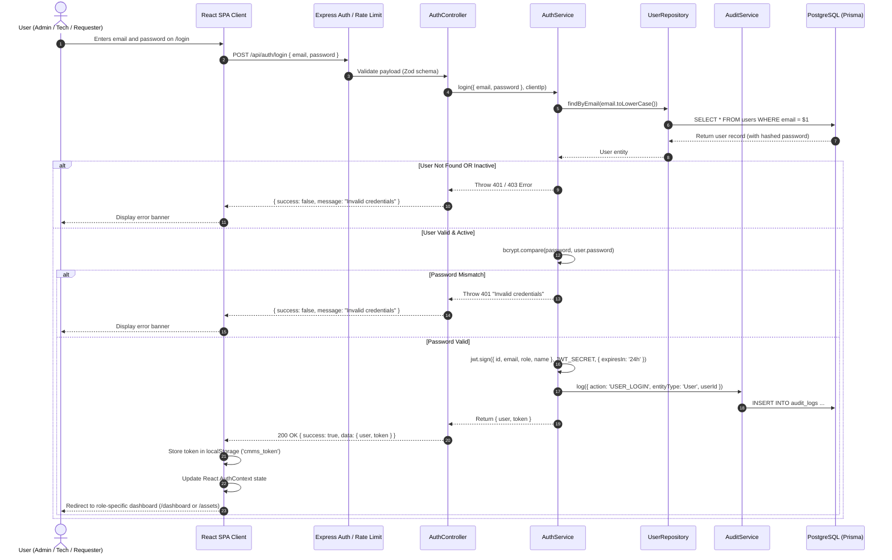

# Login Sequence Diagram — Campus CMMS

## Title
**SEQ-07: User Authentication & JWT Issuance Sequence Diagram (FR-01)**

---

## Diagram

---

## Plain-English Walkthrough (Viva Notes)

This sequence diagram illustrates the step-by-step authentication mechanism satisfying **FR-01** and **NFR-01**.

1. The user inputs their campus credentials into the React client.
2. The frontend dispatches an asynchronous HTTP POST request to `/api/auth/login`.
3. Express parses the payload and applies Zod validation to ensure non-empty and well-formed email/password fields before passing execution to `AuthController`.
4. `AuthService` normalises the email and fetches the corresponding record from the PostgreSQL `users` table via `UserRepository`.
5. If the user does not exist or has been marked inactive (`isActive: false`), the service immediately halts execution with a generic error, preventing account enumeration attacks.
6. The service compares the candidate plaintext password against the stored bcrypt hash using constant-time comparison.
7. Upon successful verification, a cryptographically signed JWT access token is generated containing the user's role and identity, and an asynchronous audit trail entry is inserted into `audit_logs`.
8. The client securely persists the JWT in browser local storage and configures Axios request interceptors to automatically attach the `Authorization: Bearer <token>` header to all subsequent API requests.
