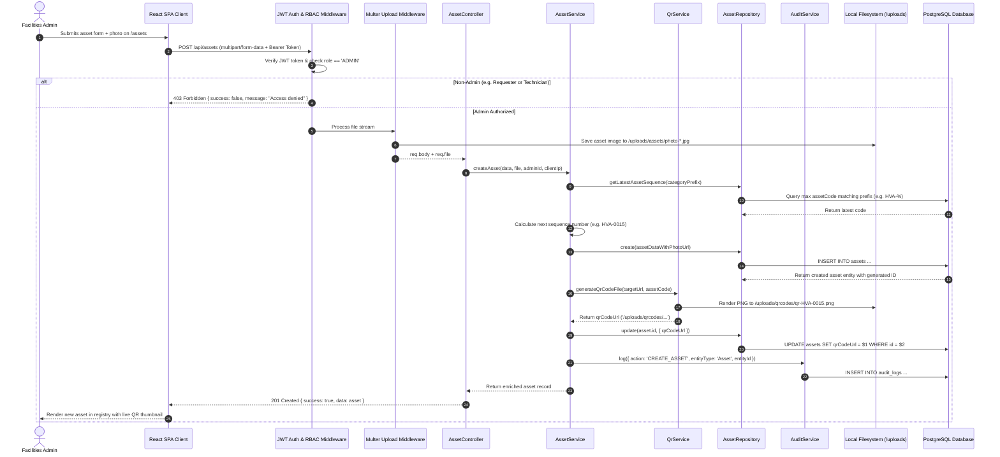

# Asset Creation Sequence Diagram — Campus CMMS

## Title
**SEQ-08: Asset Creation, QR Code Generation & Audit Logging Sequence (FR-02, FR-04, FR-13)**

---

## Diagram

---

## Plain-English Walkthrough (Viva Notes)

This sequence diagram details the end-to-end flow for registering physical campus assets, demonstrating **FR-02**, **FR-04**, and **FR-13**.

1. The Admin submits a new equipment registration form including name, category, spatial location, serial number, warranty expiry date, and optional photograph.
2. The HTTP request reaches Express with `multipart/form-data` encoding.
3. The `authenticate` and `rbac('ADMIN')` middlewares verify the JWT token signature and ensure the caller possesses administrator privileges. Any unauthorized caller receives an immediate HTTP 403 response.
4. Multer intercepts the image stream, enforces size/type constraints (max 5MB, JPEG/PNG/WebP), and writes the file to `/uploads/assets/`.
5. The `AssetService` determines the category prefix (e.g. `HVA` for HVAC, `ELE` for Electrical) and computes the next monotonic sequence number to auto-generate a human-readable asset code (e.g. `HVA-0015`).
6. The primary asset record is inserted into PostgreSQL.
7. Next, the `QrService` generates a high-resolution QR code PNG encoding the deep-link URL (`https://campus.edu/assets/{id}`) and writes the image to `/uploads/qrcodes/`.
8. The asset record is updated with the generated `qrCodeUrl`.
9. The `AuditService` records an immutable audit log entry documenting the timestamp, user ID, IP address, and asset metadata.
10. Finally, the controller returns the newly registered asset with its QR code path, allowing the administrator to preview the asset or print the sticker.
