# Backend Class Diagram — Campus CMMS

## Title
**CD-09: Backend Layered Class Diagram — Services, Repositories, and Utilities (Phase 4 Baseline)**

---

## Diagram

```mermaid
classDiagram
    %% ─── Presentation / Controller Layer ──────────────────────────────────────
    class AuthController {
        +register(req, res)
        +login(req, res)
        +logout(req, res)
        +getMe(req, res)
    }

    class UserController {
        +listUsers(req, res)
        +createUser(req, res)
        +toggleStatus(req, res)
    }

    class AssetController {
        +listAssets(req, res)
        +getAsset(req, res)
        +createAsset(req, res)
        +updateAsset(req, res)
        +deleteAsset(req, res)
        +getQrLabel(req, res)
    }

    class MaintenanceRequestController {
        +create(req, res)
        +list(req, res)
        +getById(req, res)
        +approve(req, res)
        +reject(req, res)
    }

    class WorkOrderController {
        +list(req, res)
        +getById(req, res)
        +create(req, res)
        +transitionStatus(req, res)
        +assign(req, res)
        +addNote(req, res)
        +logTime(req, res)
        +addPart(req, res)
        +removePart(req, res)
    }

    class PMScheduleController {
        +list(req, res)
        +getById(req, res)
        +create(req, res)
        +update(req, res)
        +toggleActive(req, res)
        +runNow(req, res)
    }

    class InventoryController {
        +listParts(req, res)
        +getPartById(req, res)
        +createPart(req, res)
        +updatePart(req, res)
        +listSuppliers(req, res)
        +createSupplier(req, res)
    }

    %% ─── Business Logic / Service Layer ───────────────────────────────────────
    class AuthService {
        +register(userData, clientIp) Promise~Object~
        +login(credentials, clientIp) Promise~Object~
        +getMe(userId) Promise~User~
        +generateToken(user) String
    }

    class UserService {
        +getUsers(queryOptions) Promise~PaginatedResult~
        +createUser(userData, adminId, clientIp) Promise~User~
        +toggleUserStatus(userId, isActive, adminId, clientIp) Promise~User~
    }

    class AssetService {
        +getAssets(filterOptions) Promise~PaginatedResult~
        +getAssetById(id) Promise~Asset~
        +createAsset(data, file, adminId, clientIp) Promise~Asset~
        +updateAsset(id, data, file, adminId, clientIp) Promise~Asset~
        +deleteAsset(id, adminId, clientIp) Promise~Boolean~
        +getAssetQrLabel(id) Promise~Object~
    }

    class MaintenanceRequestService {
        +createRequest(data, file, requesterId, clientIp) Promise~Request~
        +getRequests(filters) Promise~PaginatedResult~
        +getRequestById(id, user) Promise~Request~
        +approveRequest(id, params, adminId, clientIp) Promise~Object~
        +rejectRequest(id, reason, adminId, clientIp) Promise~Request~
    }

    class WorkOrderService {
        +getWorkOrders(filters) Promise~PaginatedResult~
        +getWorkOrderById(id) Promise~WorkOrder~
        +createWorkOrder(data, adminId, clientIp) Promise~WorkOrder~
        +transitionStatus(id, toStatus, reason, user, clientIp) Promise~WorkOrder~
        +assignTechnician(id, techId, adminId, clientIp) Promise~WorkOrder~
        +addNote(id, content, userId) Promise~Note~
        +logTime(id, hours, techId) Promise~WorkOrder~
    }

    class PMScheduleService {
        +getSchedules() Promise~List~
        +getScheduleById(id) Promise~PMSchedule~
        +createSchedule(data, adminId, clientIp) Promise~PMSchedule~
        +updateSchedule(id, data, adminId, clientIp) Promise~PMSchedule~
        +toggleActive(id, isActive, adminId, clientIp) Promise~PMSchedule~
        +runSchedulerNow(adminId, clientIp) Promise~Object~
    }

    class PMSchedulerService {
        +runDueSchedules(adminId, clientIp) Promise~Object~
    }

    class InventoryService {
        +getParts(options) Promise~PaginatedResult~
        +getPartById(id) Promise~Part~
        +createPart(data, adminId, clientIp) Promise~Part~
        +updatePart(id, data, adminId, clientIp) Promise~Part~
        +addPartToWorkOrder(woId, partId, qty, userId, clientIp) Promise~Object~
        +removePartFromWorkOrder(woId, partId, userId, clientIp) Promise~Object~
        +checkAndAlertLowStock(part) Promise~void~
    }

    class NotificationService {
        +notify(payload) Promise~Notification~
        +getUserNotifications(userId, pagination) Promise~Object~
        +markAsRead(id, userId) Promise~void~
        +markAllAsRead(userId) Promise~void~
    }

    class EmailService {
        +sendMail(options) Promise~Object~
        +sendAssignmentEmail(techEmail, techName, wo) Promise~void~
        +sendStatusChangeEmail(recEmail, recName, wo, from, to) Promise~void~
    }

    class AuditService {
        +log(auditData) Promise~AuditLog~
        +getLogs(filterOptions) Promise~PaginatedResult~
    }

    %% ─── Data Access / Repository Layer ───────────────────────────────────────
    class PMScheduleRepository {
        +findMany() Promise~List~
        +findById(id) Promise~PMSchedule~
        +create(data, checklist) Promise~PMSchedule~
        +update(id, data, checklist) Promise~PMSchedule~
        +toggleActive(id, isActive) Promise~PMSchedule~
    }

    class PartRepository {
        +findMany(options) Promise~PartList~
        +findById(id) Promise~Part~
        +create(data) Promise~Part~
        +update(id, data) Promise~Part~
    }

    class SupplierRepository {
        +findMany() Promise~List~
        +findById(id) Promise~Supplier~
        +create(data) Promise~Supplier~
        +update(id, data) Promise~Supplier~
    }

    class WorkOrderRepository {
        +create(data) Promise~WorkOrder~
        +findMany(options) Promise~WorkOrderList~
        +findById(id) Promise~WorkOrder~
        +update(id, data) Promise~WorkOrder~
        +addStatusHistory(data) Promise~History~
        +addNote(data) Promise~Note~
    }

    %% ─── Relationships ────────────────────────────────────────────────────────
    WorkOrderController --> InventoryService : manages parts used
    PMScheduleController --> PMScheduleService : delegates
    PMScheduleService --> PMSchedulerService : invokes scheduler
    PMSchedulerService --> WorkOrderRepository : auto-generates WOs
    PMSchedulerService --> NotificationService : alerts admins
    PMSchedulerService --> AuditService : logs runs

    InventoryService --> PartRepository : CRUD
    InventoryService --> SupplierRepository : vendor data
    InventoryService --> NotificationService : dispatches low-stock alerts
    InventoryService --> AuditService : logs stock deductions & restorations
```

---

## Plain-English Walkthrough (Viva Notes)

The class diagram updated for **Phase 4** introduces:
1. **Preventive Maintenance Engine:** `PMScheduleService` handles user CRUD and checklist configuration through `PMScheduleRepository`. It interfaces with `PMSchedulerService`, which executes the daily batch job or Admin "Run Now" trigger, checking idempotency before creating work orders.
2. **Atomic Inventory & Parts Subsystem:** `InventoryService` coordinates part stock queries and enforces transactional deductions via `prisma.$transaction`. It validates that parts requested do not exceed available on-hand stock and recalculates total job cost incorporating labor hours.
3. **Threshold Alert Integration:** When `stockQty` falls at or below `reorderLevel`, `InventoryService` calls `NotificationService` to immediately dispatch alerts to all facility administrators.
