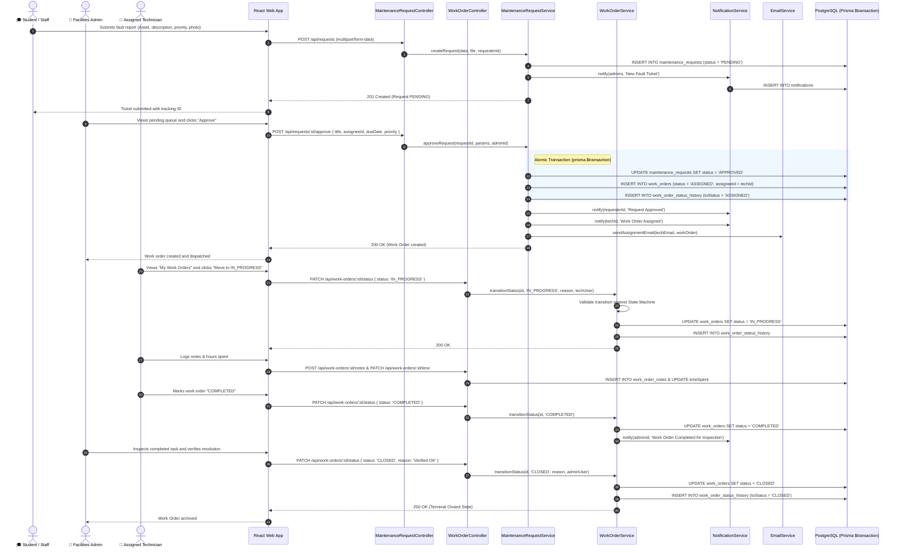

# Request to Work Order Lifecycle Sequence Diagram — Campus CMMS

## Title
**SEQ-10: End-to-End Maintenance Request to Work Order Lifecycle (FR-05, FR-06, FR-07, FR-10)**

---

## Diagram

---

## Plain-English Walkthrough (Viva Notes)

This sequence diagram depicts the end-to-end operational lifecycle from fault detection to final sign-off:

1. **Submission (FR-05):** A student or faculty member reports an issue through the web interface. The request enters the PostgreSQL database with a status of `PENDING`, and all system administrators receive an in-app alert.
2. **Atomic Approval (FR-06):** An administrator reviews the pending request and triggers approval. Crucially, this operation executes within a single **Prisma database transaction** (`prisma.$transaction`). It updates the request to `APPROVED`, instantiates the corresponding `WorkOrder`, logs the initial entry into `work_order_status_history`, and creates notification records. If any sub-query fails, the entire batch rolls back, guaranteeing that a request never produces multiple work orders or leaves orphaned records.
3. **Execution & State Machine (FR-07):** The assigned technician receives an email and an in-app alert. Using the role-scoped interface, the technician transitions the order from `ASSIGNED` to `IN_PROGRESS`, logs ongoing work notes and labour hours, and moves it to `COMPLETED`. Every transition is verified against the server-side state machine.
4. **Administrative Closure (FR-07):** The technician cannot arbitrarily close the ticket. The administrator inspects the completed work, logs a verification sign-off, and marks the work order `CLOSED`—the immutable terminal state.
