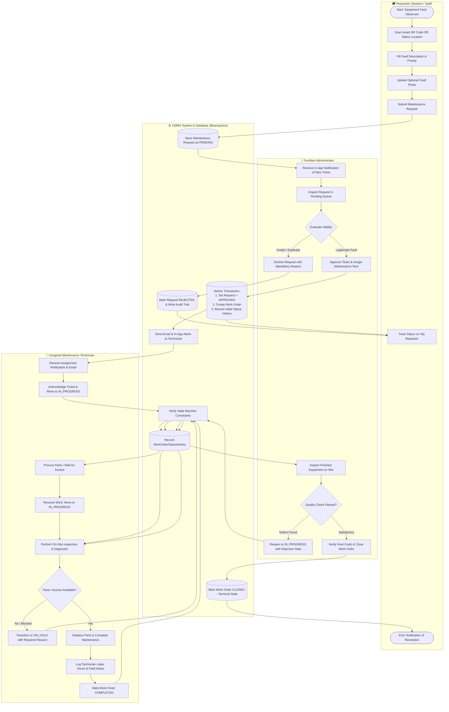

# Maintenance Request Lifecycle Activity Diagram — Campus CMMS

## Title
**ACT-11: Activity Diagram with Actor Swimlanes for Maintenance Request & Work Order Lifecycle**

---

## Diagram

---

## Plain-English Walkthrough (Viva Notes)

This activity diagram utilizes **four distinct swimlanes** (`Requester`, `Admin`, `System`, `Technician`) to illustrate concurrency, decision gates, and role boundaries:

1. **Requester Swimlane:** The requester initiates the journey by scanning a physical QR sticker or selecting a room, specifying priority and description, and submitting the request. They observe status updates asynchronously.
2. **Admin Review Gate:** The administrator evaluates the pending ticket. If rejected, a reason is documented, the ticket terminates, and the requester is notified. If approved, the system takes over.
3. **System Transaction Swimlane:** The system performs transactional conversion—guaranteeing that exactly one work order is spawned and the initial status history is appended. The system automatically dispatches email and in-app alerts to the designated technician.
4. **Technician Workflow & Exception Handling:** The technician acknowledges the ticket, transitioning it to `IN_PROGRESS`. If parts or access are missing, the technician can trigger an `ON_HOLD` sub-loop with a mandatory reason. Once resolved, the technician logs labour time and notes and submits the work as `COMPLETED`.
5. **Quality Verification Gate:** The administrator inspects the repaired equipment. If quality standards are unmet, the administrator can reopen the work order back to `IN_PROGRESS`. If verified, the administrator executes the final transition to `CLOSED`, concluding the lifecycle.
