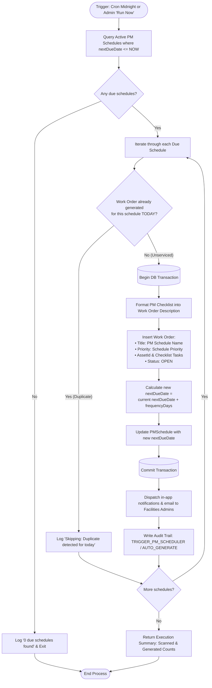

# 12 — Preventive Maintenance (PM) Scheduler Activity Diagram

This activity diagram details the background automated Preventive Maintenance cycle (FR-08) orchestrated via `node-cron` and on-demand Admin trigger execution. It highlights query criteria, duplicate suppression (idempotency guard), checklist cloning, work order dispatch, and the next-due calculation.

---

### Plain-English Viva Walkthrough (5–10 Lines)
1. **Trigger Mechanism:** The scheduler runs automatically on a scheduled cron cadence (default midnight daily) and can also be triggered synchronously by an Admin via `POST /api/pm-schedules/run-now`.
2. **Detection & Filtering:** The service queries all `PMSchedule` records that are active (`isActive = true`) and have reached or surpassed their scheduled due timestamp (`nextDueDate <= NOW()`).
3. **Strict Idempotency Guard:** To prevent duplicate work orders if the scheduler triggers multiple times within the same day, the query inspects whether a work order linked to `pmScheduleId` with `createdAt >= startOfToday` already exists.
4. **Atomic Transaction:** Inside a single PostgreSQL transaction (`prisma.$transaction`), the system creates an `OPEN` work order, copies all ordered checklist items into the task scope, advances `nextDueDate` by the schedule's `frequencyDays`, and registers the initial status history.
5. **Notification & Audit:** Facilities managers and technicians receive in-app notifications upon generation, and a permanent entry is recorded in `audit_logs` detailing the execution outcome.
