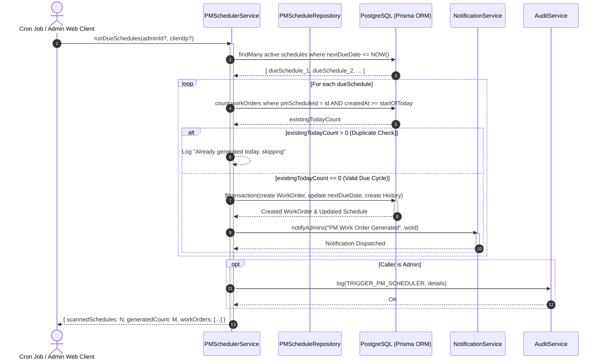

# 13 — Preventive Maintenance (PM) Scheduler Sequence Diagram

This sequence diagram depicts the chronological interaction between the Cron/Admin caller, `PMSchedulerService`, PostgreSQL Database via Prisma, and `NotificationService` during periodic work order generation (FR-08).

---

### Plain-English Viva Walkthrough (5–10 Lines)
1. **Invocation:** The process starts when `node-cron` fires its scheduled event or an administrator clicks "Run Scheduler Now" in the UI.
2. **Identification:** `PMSchedulerService` queries the database for all enabled PM schedules whose `nextDueDate` has arrived.
3. **Deduplication Check:** Before generating any ticket, the scheduler checks if a work order with the same `pmScheduleId` was already generated earlier today. If found, the schedule is gracefully skipped.
4. **Atomic Provisioning:** If unserviced, the scheduler initiates an ACID transaction creating the new work order with all checklist tasks embedded and pushing `nextDueDate` forward by `frequencyDays`.
5. **Notification & Completion:** Notifications are emitted to relevant staff, the action is logged to the system audit trail, and a execution summary (`scanned` vs `generated`) is returned to the client.
