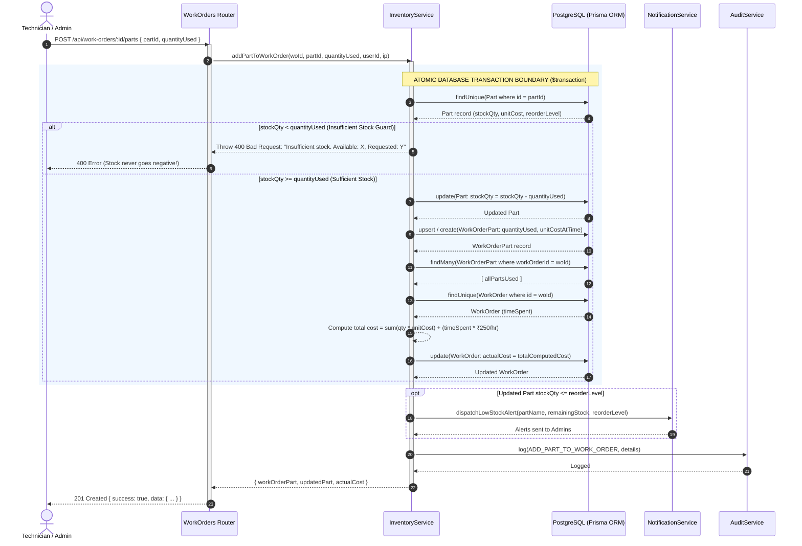

# 14 — Inventory Stock Deduction & Cost Calculation Sequence Diagram

This sequence diagram illustrates the atomic transaction boundary, concurrency protection, low-stock threshold alerting, and work order cost recomputation when a technician records parts consumed on a work order (FR-09).

---

### Plain-English Viva Walkthrough (5–10 Lines)
1. **Request Intake:** A technician adds consumable parts used during maintenance through `POST /api/work-orders/:id/parts`.
2. **Transaction Isolation:** All operations run within an ACID database transaction (`prisma.$transaction`) to guarantee atomicity and avoid race conditions or inventory inconsistency.
3. **No-Negative Stock Rule:** If the current `stockQty` is less than the requested quantity, the transaction throws an immediate 400 Bad Request exception, ensuring stock levels can never go negative.
4. **Unit Cost Snapshotting:** When deducted, the part's current `unitCost` is snapshotted into `unitCostAtTime` so subsequent supplier price hikes do not retroactively alter historic job costs.
5. **Dynamic Cost Recomputation:** The work order's `actualCost` is recalculated dynamically as: `(SUM(parts * unitCostAtTime)) + (labour hours * ₹250/hr)`.
6. **Low-Stock Notification:** If the remaining stock falls at or below `reorderLevel`, the service dispatches in-app alerts and warning emails to administrators.
