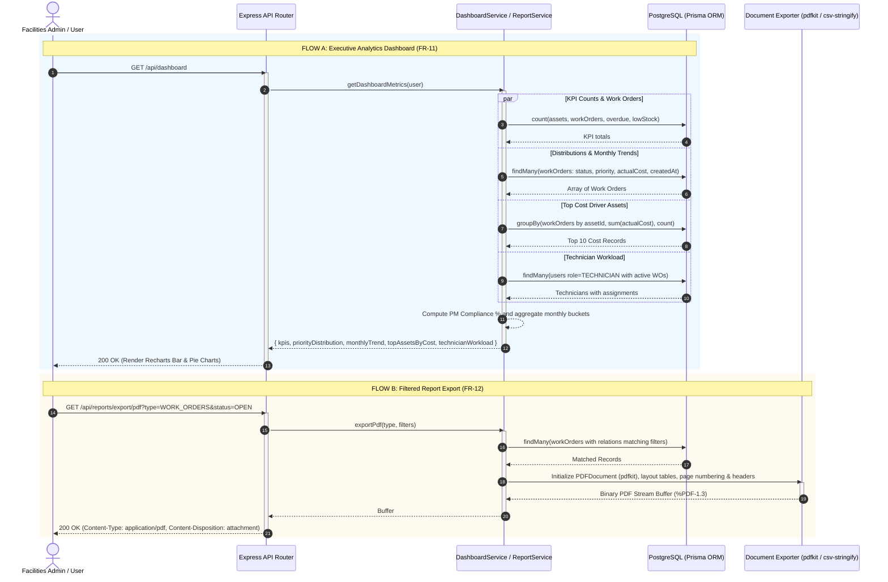

# 15 — Analytics Dashboard & Report Generation Sequence Diagram

This sequence diagram depicts the chronological interaction between the Client (Browser), API Controllers, Business Logic Services, PostgreSQL Database, and Document Exporters (`pdfkit` and `csv-stringify`) during executive reporting and data analytics queries (FR-11, FR-12).

---

### Plain-English Viva Walkthrough (5–10 Lines)
1. **Parallel Aggregations:** When an administrator opens the dashboard, `DashboardService` executes parallel database queries (`Promise.all`) covering asset counts, overdue work orders, low stock items, and historical cost groups.
2. **In-Memory Transformation:** Raw database counts are converted into structured formats matching **Recharts** chart requirements: donut charts for priority distribution and stacked bar charts for monthly trends.
3. **Role Awareness:** If accessed by a technician, the service aggregates personal workload and urgent assignments; for a student or staff requester, it summarizes personal fault tickets.
4. **Data Export Pipeline:** When exporting reports, `ReportService` queries filtered records and pipes the dataset directly into `csv-stringify` for tabular spreadsheets or `pdfkit` for styled executive documents.
5. **Direct Binary Streaming:** PDF documents are compiled in memory with headers, alternating row fills, and totals, then streamed with `Content-Type: application/pdf` for immediate browser download.
