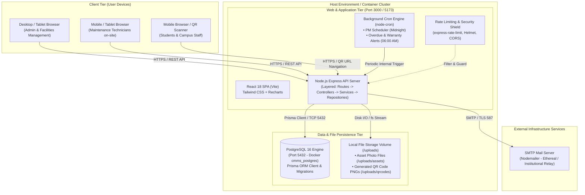

# 16 — System Deployment Diagram

This UML deployment diagram depicts the physical and operational deployment topology of the Campus Computerised Maintenance Management System (CMMS), illustrating client web browsers, the Node.js Express application container, PostgreSQL database engine, file storage, and external SMTP services.

---

### Plain-English Viva Walkthrough (5–10 Lines)
1. **Client Tier:** End users interact with the system via standard desktop and mobile browsers. Students scan physical asset QR codes directly using device cameras, which deep-link into the React single-page application.
2. **Application Tier:** The Node.js Express server is built with a 4-tier clean architecture (Routes $\rightarrow$ Controllers $\rightarrow$ Services $\rightarrow$ Repositories). It enforces role-based access control and rate limiting on sensitive authentication routes.
3. **Background Services:** Embedded within the server process, `node-cron` orchestrates autonomous jobs for midnight preventive maintenance generation and 6:00 AM overdue/warranty alert scanning.
4. **Data Persistence Tier:** All transactional relational entities are stored in a Dockerized PostgreSQL 16 database accessed through the Prisma ORM. Uploaded asset photographs and generated QR codes are persisted on the local volume (`/uploads`).
5. **External Integrations:** Outgoing assignment notices and status notifications are dispatched asynchronously via Nodemailer through an institutional or development SMTP service.
